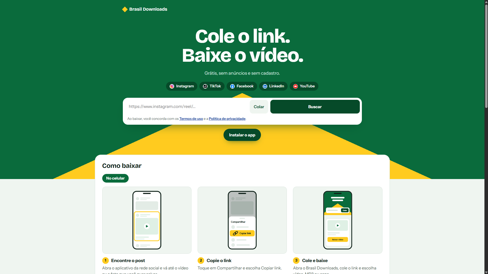
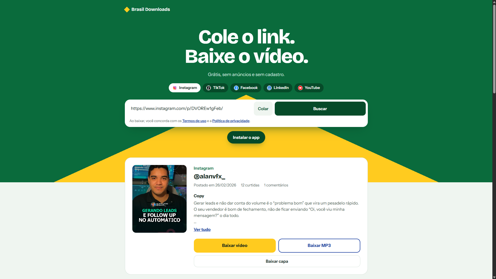
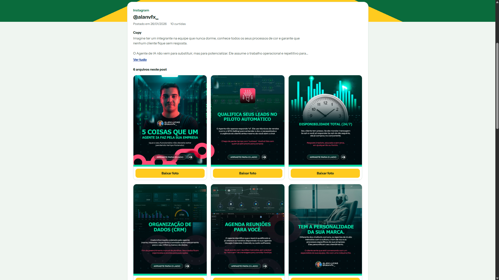
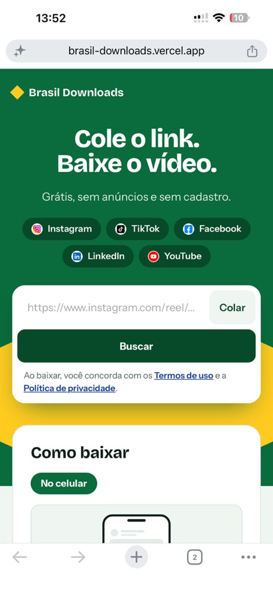
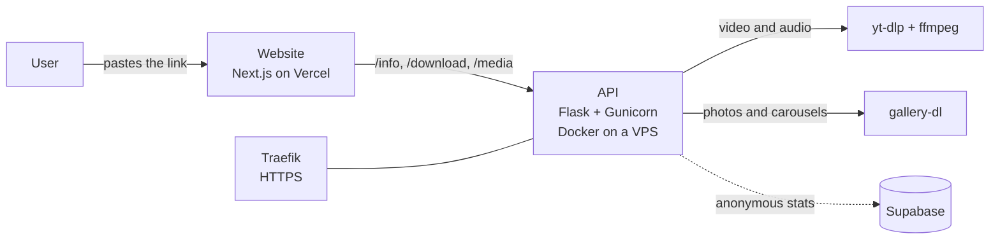

<div align="center">


# Brasil Downloads

**Paste the link. Get the video.**

Download videos, MP3 audio, photos and carousels from social media. No ads, no sign-up, no pop-ups.

[**Open the site**](https://brasil-downloads.vercel.app) · [Versão em português](README.md)


</div>

---

## Why it exists

Anyone who has tried to download a social media video knows the drill: sites packed with ads, fake "Download" buttons, pop-ups and malware risk. That happens because downloading and converting video costs server time and bandwidth, and the bill is usually paid with aggressive ad networks.

Brasil Downloads is the clean version of that tool: one page, one field, zero ads. It started as a portfolio project, built from scratch, from the API to the deploy.

## Screenshots

| Home page | Video ready to download |
|---|---|
|  |  |

| Instagram carousel | On mobile, installed as an app |
|---|---|
|  |  |

## Features

- **MP4 video** with quality selection (1080p, 720p, 480p...)
- **MP3 audio**, converted on the server
- **Cover image** of the video
- **Instagram carousels and photos**, with one button per card
- **Full caption**, author, date and likes
- **Auto search**: paste the link and the search starts on its own
- **Installable app** on Android and iPhone, straight from the browser, no app store
- **Share → Brasil Downloads** on Android: the link arrives ready in the app
- **Responsive**, from phones to large monitors

### Supported networks

| Network | Video | MP3 | Cover | Photos and carousels |
|---|:---:|:---:|:---:|:---:|
| Instagram | ✅ | ✅ | ✅ | ✅ |
| TikTok | ✅ | ✅ | ✅ | |
| Facebook | ✅ | ✅ | ✅ | |
| YouTube | ✅ | ✅ | ✅ | |
| LinkedIn | ✅ | ✅ | ✅ | |

## How it works



1. The **website** detects the network from the link and asks the API for the post data.
2. The **API** uses `yt-dlp` for videos and `gallery-dl` for photos and carousels, and returns the title, caption, cover and available qualities.
3. On download, the API fetches the file, converts it with `ffmpeg` when needed (MP3, merging video and audio) and sends it to the user. The file is deleted from the server right after.
4. Each download writes one anonymous stats row: network, file type, device type, date and whether it succeeded.

## Tech stack

| Layer | Technology |
|---|---|
| Website | Next.js, React, TypeScript, plain CSS |
| App | PWA (web app manifest with Web Share Target) |
| API | Python, Flask, Gunicorn |
| Downloading | yt-dlp, gallery-dl, ffmpeg |
| Infrastructure | Docker, Docker Compose, Traefik with automatic HTTPS (Let's Encrypt), Hostinger VPS |
| Website hosting | Vercel, auto-deployed on every `git push` |
| Analytics | Supabase (PostgreSQL) |

## Security and privacy

- **No personal data in the stats.** The database stores only network, file type, device type, date and success. Neither the link nor the IP is saved.
- **Temporary files.** Each download uses a temporary folder that is deleted after sending.
- **Origin lock (CORS).** The API only answers browser calls coming from the official site.
- **Per-visitor rate limit**, to protect the server from abuse.
- **Domain allowlist.** The API only accepts links from supported networks, so it can't be used to fetch arbitrary URLs.
- **Secrets stay out of the repo.** Keys and cookies live in files ignored by Git and Docker.

## Run it locally

Requirements: Python 3.11+, Node.js LTS and ffmpeg.

**API** (`api` folder):

```bash
cd api
python -m venv .venv
.venv\Scripts\activate        # Windows
# source .venv/bin/activate   # Mac/Linux
pip install -r requirements.txt
python app.py                 # http://localhost:8000
```

**Website** (`web` folder, in another terminal):

```bash
cd web
npm install
npm run dev                   # http://localhost:3000
```

### Environment variables

Create `api/.env` (optional, each part works without the other):

```env
# Analytics (Supabase)
SUPABASE_URL=
SUPABASE_KEY=

# Contact form (Gmail with an app password)
CONTACT_TO=
SMTP_USER=
SMTP_PASS=
```

On the website, `NEXT_PUBLIC_API_URL` sets the API address. Without it, the site uses `http://localhost:8000`.

For Instagram photos and carousels, the API needs `api/cookies-instagram.txt`, exported from an Instagram account logged in on the browser. Use a secondary account.

## Deployment

| Part | Where | How it updates |
|---|---|---|
| Website | Vercel (`web` folder) | Automatically, on every `git push` |
| API | VPS with Docker and Traefik | `git pull` and `docker compose up -d --build` |

## Project structure

```
brasil-downloads/
├── api/                  Python API
│   ├── app.py            /info, /download, /thumbnail routes and security
│   ├── gallery.py        photos and carousels (gallery-dl)
│   ├── stats.py          anonymous analytics
│   ├── contact.py        contact form
│   ├── platforms.py      supported networks
│   └── Dockerfile
├── web/                  Next.js website
│   ├── app/              pages, components and styles
│   └── public/           icons, logos, illustrations and app manifest
└── docker-compose.yml    server configuration for the API
```

## Roadmap

- [ ] Photos from Facebook posts
- [ ] Instagram profile with the latest posts
- [ ] Chrome extension
- [ ] Contact form enabled

## Disclaimer

Use Brasil Downloads only to download your own content or content you have the author's permission to download. The rights to each video, audio or image belong to its creator. This project is not affiliated with Instagram, TikTok, Facebook, LinkedIn or YouTube.

---

<div align="center">

Built by **Alan Lucas Pereira** · [GitHub](https://github.com/alanlucas92)

</div>
