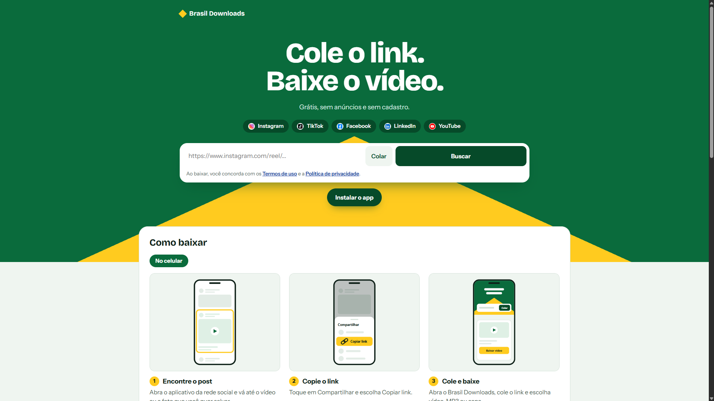
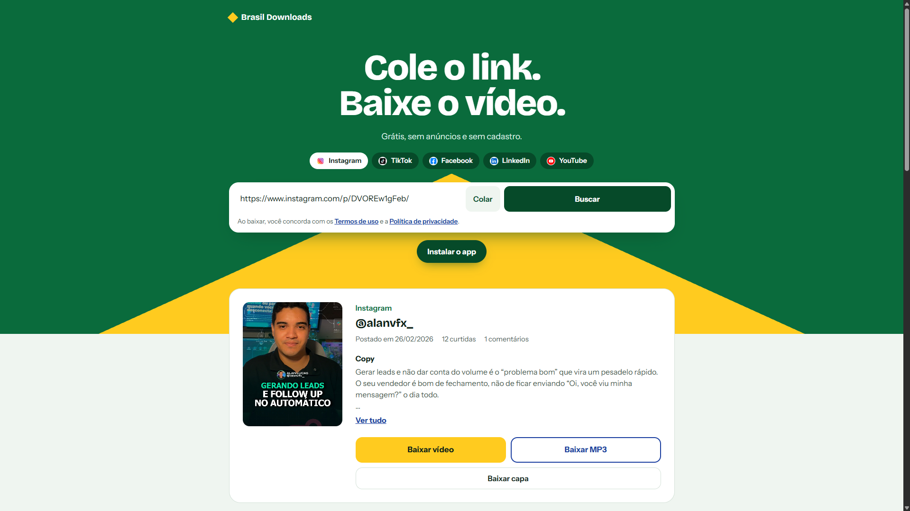
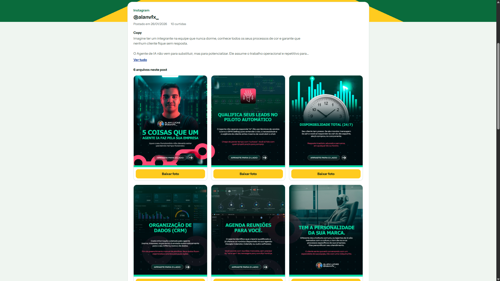
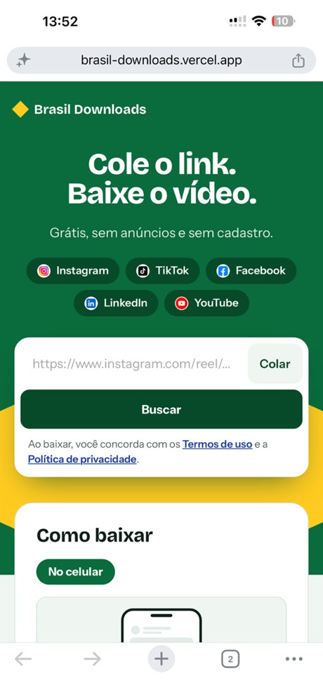
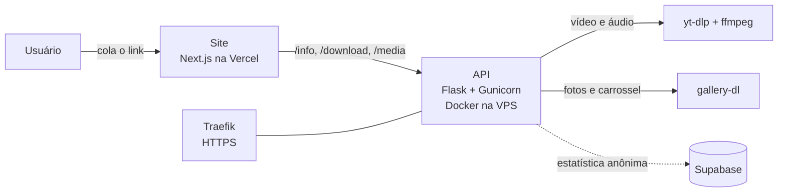

<div align="center">


# Brasil Downloads

**Cole o link. Baixe o vídeo.**

Baixe vídeos, áudio em MP3, fotos e carrosséis das redes sociais, sem anúncios, sem cadastro e sem pop-up.

[**Acessar o site**](https://brasil-downloads.vercel.app) · [English version](README.en.md)


</div>

---

## Por que existe

Quem já tentou baixar um vídeo de rede social conhece o roteiro: sites lotados de anúncios, botões falsos de "Download", pop-ups e risco de vírus. Isso acontece porque baixar e converter vídeo custa servidor e banda, e a conta costuma ser paga com redes de anúncio agressivas.

O Brasil Downloads é a versão limpa dessa ferramenta: uma página, um campo, nenhum anúncio. Nasceu como projeto de portfólio, construído do zero, da API ao deploy.

## Telas

| Página inicial | Vídeo pronto para baixar |
|---|---|
|  |  |

| Carrossel do Instagram | No celular, instalado como app |
|---|---|
|  |  |

## O que ele faz

- **Vídeo em MP4** com escolha de qualidade (1080p, 720p, 480p...)
- **Áudio em MP3**, convertido no servidor
- **Capa** do vídeo em imagem
- **Carrossel e fotos** do Instagram, com um botão para cada card
- **Legenda completa**, autor, data e curtidas do post
- **Busca automática**: colou o link, a busca começa sozinha
- **App instalável** no Android e no iPhone, direto pelo navegador, sem loja
- **Compartilhar → Brasil Downloads** no Android: o link chega pronto no app
- **Responsivo**, do celular ao monitor grande

### Redes suportadas

| Rede | Vídeo | MP3 | Capa | Fotos e carrossel |
|---|:---:|:---:|:---:|:---:|
| Instagram | ✅ | ✅ | ✅ | ✅ |
| TikTok | ✅ | ✅ | ✅ | |
| Facebook | ✅ | ✅ | ✅ | |
| YouTube | ✅ | ✅ | ✅ | |
| LinkedIn | ✅ | ✅ | ✅ | |

## Como funciona



1. O **site** identifica a rede pelo link e pede os dados do post para a API.
2. A **API** usa o `yt-dlp` para vídeos e o `gallery-dl` para fotos e carrosséis, e devolve título, legenda, capa e qualidades disponíveis.
3. No download, a API baixa o arquivo, converte com `ffmpeg` quando precisa (MP3, juntar vídeo e áudio) e envia para o usuário. O arquivo é apagado do servidor logo em seguida.
4. Cada download gera uma linha anônima de estatística: rede, tipo, aparelho, data e se deu certo.

## Tecnologias

| Camada | Tecnologia |
|---|---|
| Site | Next.js, React, TypeScript, CSS puro |
| App | PWA (manifesto web com Web Share Target) |
| API | Python, Flask, Gunicorn |
| Download | yt-dlp, gallery-dl, ffmpeg |
| Infraestrutura | Docker, Docker Compose, Traefik com HTTPS automático (Let's Encrypt), VPS Hostinger |
| Hospedagem do site | Vercel, com deploy automático a cada `git push` |
| Estatísticas | Supabase (PostgreSQL) |

## Segurança e privacidade

- **Nada de dados pessoais nas estatísticas.** O banco guarda só rede, tipo de arquivo, tipo de aparelho, data e sucesso. Nem o link nem o IP são salvos.
- **Arquivos temporários.** Cada download usa uma pasta temporária que é apagada depois do envio.
- **Trava de origem (CORS).** A API só responde a chamadas do navegador vindas do site oficial.
- **Limite de uso por visitante**, para proteger o servidor de abuso.
- **Lista fechada de domínios.** A API só aceita links das redes suportadas, o que impede usá-la para acessar qualquer endereço da internet.
- **Segredos fora do repositório.** Chaves e cookies ficam em arquivos ignorados pelo Git e pelo Docker.

## Rodar no seu computador

Pré-requisitos: Python 3.11+, Node.js LTS e ffmpeg.

**API** (pasta `api`):

```bash
cd api
python -m venv .venv
.venv\Scripts\activate        # Windows
# source .venv/bin/activate   # Mac/Linux
pip install -r requirements.txt
python app.py                 # http://localhost:8000
```

**Site** (pasta `web`, em outro terminal):

```bash
cd web
npm install
npm run dev                   # http://localhost:3000
```

### Variáveis de ambiente

Crie `api/.env` (opcional, cada parte funciona sem a outra):

```env
# Estatísticas (Supabase)
SUPABASE_URL=
SUPABASE_KEY=

# Formulário de contato (Gmail com senha de app)
CONTACT_TO=
SMTP_USER=
SMTP_PASS=
```

No site, `NEXT_PUBLIC_API_URL` define o endereço da API. Sem ela, o site usa `http://localhost:8000`.

Para fotos e carrosséis do Instagram, a API precisa de `api/cookies-instagram.txt`, exportado de uma conta do Instagram logada no navegador. Use uma conta secundária.

## Publicação

| Parte | Onde | Como atualiza |
|---|---|---|
| Site | Vercel (pasta `web`) | Sozinho, a cada `git push` |
| API | VPS com Docker e Traefik | `git pull` e `docker compose up -d --build` |

## Estrutura

```
brasil-downloads/
├── api/                  API em Python
│   ├── app.py            rotas /info, /download, /thumbnail e segurança
│   ├── gallery.py        fotos e carrosséis (gallery-dl)
│   ├── stats.py          estatísticas anônimas
│   ├── contact.py        formulário de contato
│   ├── platforms.py      redes aceitas
│   └── Dockerfile
├── web/                  site em Next.js
│   ├── app/              páginas, componentes e estilos
│   └── public/           ícones, logos, ilustrações e manifesto do app
└── docker-compose.yml    configuração da API no servidor
```

## Próximos passos

- [ ] Fotos de posts do Facebook
- [ ] Perfil do Instagram com os últimos posts
- [ ] Extensão para o Chrome
- [ ] Formulário de contato ativo

## Aviso

Use o Brasil Downloads apenas para baixar conteúdo seu ou com autorização do autor. Os direitos de cada vídeo, áudio ou imagem pertencem a quem o criou. Este projeto não tem vínculo com Instagram, TikTok, Facebook, LinkedIn ou YouTube.

---

<div align="center">

Feito por **Alan Lucas Pereira** · [GitHub](https://github.com/alanlucas92)

</div>
